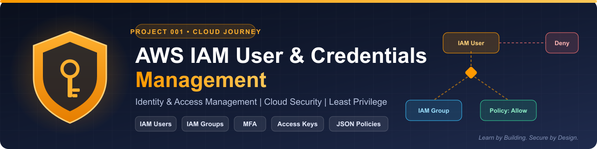

<div align="center">



### 🔐 AWS Cloud Engineering | Identity & Access Management | Cloud Security

**Learn by Building. Secure by Design. Improve with Every Project.**

</div>

---

## 🧭 Project Navigation

| Section                                            | Description                 |
| -------------------------------------------------- | --------------------------- |
| [📌 Overview](#-project-overview)                  | Introduction to the project |
| [🎯 Objectives](#-project-objectives)              | Learning goals              |
| [🏗️ Environment](#️-aws-environment)              | Lab configuration           |
| [📖 Concepts](#-concepts-covered)                  | IAM fundamentals            |
| [🔨 Implementation](#-implementation-and-progress) | Practical implementation    |
| [🔐 Security](#-security-implementation)           | Security controls           |
| [📸 Evidence](#-project-evidence)                  | Screenshots                 |
| [🧠 Learnings](#-key-learnings)                    | Lessons learned             |
| [🎤 Interviews](#-interview-preparation)           | Interview questions         |
| [💰 Cost](#-cost-considerations)                   | AWS pricing considerations  |
| [📚 References](#-official-aws-references)         | Official documentation      |

---

## 📌 Project Overview

Welcome to **Project 001** of my **Cloud Journey**, where I am transitioning from cybersecurity foundations into practical AWS Cloud Engineering and Cloud Security.

This project focuses on understanding and implementing **AWS Identity and Access Management (IAM)**, one of the foundational services responsible for controlling access to AWS resources.

Through this hands-on lab, I explored how AWS identities are created, authenticated, secured and organized using IAM users, groups, credentials and Multi-Factor Authentication (MFA).

The project also demonstrates how the **Principle of Least Privilege** helps prevent unnecessary access to cloud resources.

### 💡 Real-world relevance

In enterprise environments, identity security is one of the most important aspects of cloud security.

A compromised identity with excessive permissions can create serious security risks, including unauthorized access, data exposure and infrastructure modification.

This project establishes the foundation for understanding and preventing such risks.

---

## 🎯 Project Objectives

- [x] Understand the purpose of AWS IAM.
- [x] Understand the AWS root user and IAM user.
- [x] Create and configure an IAM user.
- [x] Configure AWS Management Console access.
- [x] Understand IAM groups and permission management.
- [x] Configure Multi-Factor Authentication (MFA).
- [x] Understand authentication versus authorization.
- [ ] Explore IAM policies and JSON permissions.
- [ ] Understand programmatic access and access key security.
- [ ] Validate specific allowed and denied IAM actions.
- [x] Apply the principle of least privilege.
- [ ] Complete final documentation and cleanup review.

---

## 🏗️ AWS Environment

| Component      | Details                                |
| -------------- | -------------------------------------- |
| Cloud Provider | Amazon Web Services                    |
| AWS Service    | Identity and Access Management         |
| Region         | Asia Pacific (Mumbai) — console region |
| Project Type   | Hands-on Security Lab                  |
| Difficulty     | Beginner                               |
| Primary Focus  | Identity and Credential Management     |
| Account Type   | AWS Free Tier account                  |
| IAM Username   | `cloud-journey-lab-user`               |
| IAM Group      | `cloud-journey-lab-group`              |
| Console Access | Enabled                                |
| MFA            | Configured                             |
| Project Status | Core implementation completed          |

---

## 🧰 AWS Services and Tools

| Service / Tool         | Purpose                                       |
| ---------------------- | --------------------------------------------- |
| AWS IAM                | Identity and access management                |
| AWS Management Console | Managing AWS services through a web interface |
| Virtual MFA            | Additional authentication security            |
| GitHub                 | Version control and project documentation     |
| Markdown               | Technical documentation                       |

---

## 📖 Concepts Covered

### 1️⃣ AWS Root User

The AWS root user is the original identity created when an AWS account is registered.

It has extensive access to the account and should be protected carefully.

**Security practices:**

- Enable MFA.
- Avoid everyday usage.
- Avoid creating root access keys.
- Secure account recovery methods.

### 2️⃣ IAM User

An IAM user represents an identity within an AWS account.

An IAM user can have console credentials and permissions assigned through applicable policies.

For this lab, I created:

`cloud-journey-lab-user`

> **Production consideration:** AWS generally recommends federated access and temporary credentials for human users rather than creating long-lived IAM users unnecessarily.

### 3️⃣ IAM Groups

IAM groups allow administrators to organize IAM users according to their responsibilities.

For this project, I created:

`cloud-journey-lab-group`

The user was added to this dedicated group to understand centralized permission management.

### 4️⃣ Authentication vs. Authorization

**Authentication:** Verifies the identity of a person or service requesting access.

**Authorization:** Determines whether the authenticated identity is permitted to perform a requested action.

An IAM user can successfully sign in while still receiving an `Access Denied` response when requesting an unauthorized operation.

### 5️⃣ Authentication Credentials

This project explores:

- Console passwords.
- Access Key IDs.
- Secret Access Keys.
- Multi-Factor Authentication.

**Security note:** No actual passwords, access keys, secret keys or MFA recovery information are stored in this repository.

### 6️⃣ IAM Policies

IAM policies are JSON documents that define permissions.

Important policy elements include:

- `Effect`
- `Action`
- `Resource`
- `Condition`

These elements will be explored through the policy exercises in the next stage.

### 7️⃣ Principle of Least Privilege

Least privilege means granting only the minimum permissions required to perform a specific task.

This reduces the potential impact of compromised credentials and unauthorized activities.

---

## 🔨 Implementation and Progress

The project is being implemented in progressive stages.

| Task   | Implementation                   | Status      |
| ------ | -------------------------------- | ----------- |
| 001.1  | Review root account security     | ✅ Completed |
| 001.2  | Verify account recovery access   | ✅ Completed |
| 001.3  | Create IAM group                 | ✅ Completed |
| 001.4  | Create IAM user                  | ✅ Completed |
| 001.5  | Configure console password       | ✅ Completed |
| 001.6  | Configure IAM user MFA           | ✅ Completed |
| 001.7  | Verify IAM user login            | ✅ Completed |
| 001.8  | Study IAM policy permissions     | 🔄 Pending  |
| 001.9  | Validate access-control behavior | 🔄 Pending  |
| 001.10 | Final documentation and cleanup  | 🔄 Pending  |

### 👤 IAM User Configuration

| Configuration       | Value                          |
| ------------------- | ------------------------------ |
| Username            | `cloud-journey-lab-user`       |
| Group               | `cloud-journey-lab-group`      |
| Password            | AWS-generated initial password |
| Password Reset      | Required at first login        |
| MFA                 | Enabled                        |
| AdministratorAccess | Not intentionally granted      |

**Permission observation:** The IAM user creation review displayed the AWS-managed `IAMUserChangePassword` policy. This supports the user's ability to change their own console password and does not provide administrative access.

---

## 🔐 Security Implementation

The following security controls were implemented or reviewed.

| Security Control                | Result                                    |
| ------------------------------- | ----------------------------------------- |
| Root account MFA                | ✅ Enabled                                 |
| Root access keys                | ✅ None present during review              |
| Account recovery access         | ✅ Verified                                |
| Dedicated IAM group             | ✅ Created                                 |
| IAM user                        | ✅ Created                                 |
| Initial password reset          | ✅ Configured                              |
| IAM user MFA                    | ✅ Configured                              |
| Broad administrator permissions | ✅ Avoided                                 |
| Least privilege                 | ✅ Applied as the initial design principle |

### 🔎 Practical Security Observation

During the first IAM user login, some dashboard features displayed `Access denied`.

Examples included:

- AWS Cost and Usage.
- Billing-related information.
- AWS Health.

This demonstrated an important security principle:

**Successful authentication does not guarantee authorization to access every AWS service.**

The user must have appropriate permissions for the requested operation.

---

## 📸 Project Evidence

Screenshots are maintained in the `screenshots/` directory.

| Screenshot                     | Description                     |
| ------------------------------ | ------------------------------- |
| `01-iam-permissions-setup.png` | IAM permissions configuration   |
| `02-iam-review-screen.png`     | Review before creating the user |
| `03-iam-user-first-login.png`  | Successful IAM user login       |

Additional sanitized evidence will be added as the project progresses.

### 🖼️ Implementation Preview

**IAM Permissions Setup**


**IAM User Review**


**Successful IAM User Login**


> ⚠️ Before publishing screenshots, remove account identifiers, personal account details, passwords, access keys, secret keys, MFA QR codes and other sensitive information.

---

## 📂 Repository Structure

```text
IAM/
│
├── README.md
│
├── assets/
│   └── banner.svg
│
├── policies/
│   ├── .gitkeep
│   └── (IAM JSON policy examples will be added here)
│
├── screenshots/
│   ├── 01-iam-permissions-setup.png
│   ├── 02-iam-review-screen.png
│   └── 03-iam-user-first-login.png
│
├── lessons-learned.md
│
└── LICENSE
```

---

## 🧠 Key Learnings

Throughout this project, I learned:

- The importance of securing the AWS root account.
- The purpose of IAM users and groups.
- The difference between authentication and authorization.
- How MFA strengthens identity security.
- How IAM policies control access.
- Why newly created IAM users have no permissions by default.
- Why Access Denied messages can be expected security outcomes.
- How least privilege reduces cloud security risks.
- Why temporary credentials are preferred for human access in production environments.

📖 **Detailed documentation:** [Read Lessons Learned](lessons-learned.md)

---

## 🎤 Interview Preparation

The following questions are associated with this project:

1. What is AWS IAM?
2. What is the difference between the root user and an IAM user?
3. What is an IAM group?
4. What is an IAM policy?
5. What is the principle of least privilege?
6. What is the difference between authentication and authorization?
7. What is the difference between console access and programmatic access?
8. What are Access Key IDs and Secret Access Keys?
9. Why is MFA important?
10. What happens when an IAM user has no permissions?
11. What is the difference between an IAM user and an IAM role?
12. What are temporary credentials?
13. What is the difference between implicit deny and explicit deny?
14. Why should credentials never be committed to GitHub?

---

## 💰 Cost Considerations

AWS IAM's core identity and access management features do not carry an additional service charge.

This project focuses on IAM and does not require launching EC2 instances, creating databases or deploying networking infrastructure.

However:

- Other AWS services may incur charges.
- Optional security and monitoring services may have separate pricing.
- Always review the official AWS pricing documentation.
- Monitor AWS Billing and Cost Management.
- Never assume that every AWS Free Tier service or feature is free.

🔗 [AWS Pricing](https://aws.amazon.com/pricing/)

---

## 🧹 Cleanup and Security Review

Before considering the project fully closed:

- [ ] Review the IAM user's permissions.
- [ ] Review group membership and attached policies.
- [ ] Confirm MFA configuration.
- [ ] Review unused credentials.
- [ ] Remove unnecessary test identities if no longer needed.
- [ ] Check for unintended AWS resources.
- [ ] Review billing information through an appropriately authorized account identity.
- [ ] Ensure the repository contains no secrets.

---

## 🚀 What's Next?

The next stage of this project focuses on **AWS IAM Policy Management**.

Planned practical exercises:

1. Understand IAM JSON policy structure.
2. Create a custom read-only policy.
3. Understand `Allow` and `Deny`.
4. Explore `Action` and `Resource`.
5. Understand policy `Condition`.
6. Compare implicit deny and explicit deny.
7. Test permissions safely.
8. Document policy behavior.

This will build the foundation for more advanced cloud security projects.

---

## 📚 Official AWS References

- [AWS IAM Documentation](https://docs.aws.amazon.com/IAM/latest/UserGuide/introduction.html)
- [IAM Security Best Practices](https://docs.aws.amazon.com/IAM/latest/UserGuide/best-practices.html)
- [IAM Policies](https://docs.aws.amazon.com/IAM/latest/UserGuide/access_policies.html)
- [AWS Shared Responsibility Model](https://aws.amazon.com/compliance/shared-responsibility-model/)
- [AWS Pricing](https://aws.amazon.com/pricing/)

---

## 👨‍💻 Author

**Aditya Srichandan**

☁️ Cloud Journey — AWS Cloud Engineering & Cloud Security

This project is part of my ongoing journey from cybersecurity foundations toward practical AWS Cloud Engineering and Cloud Security skills.

---

<div align="center">

### ⭐ Learn by Building. Secure by Design. Improve with Every Project.

**Project 001 | AWS IAM User and Credentials Management**

</div>